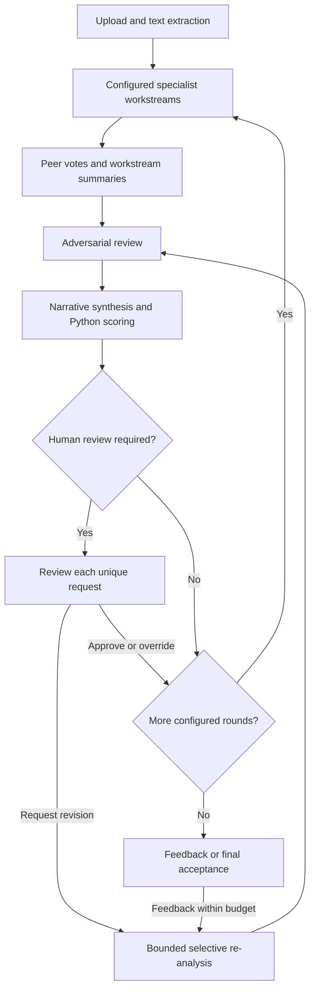

# Gilberto: bounded contract-review workflow

Reviewed 22 October 2026. Confidence: **4/5 for the engineering recommendation**, not a measure of legal accuracy. This review applies the software-development, design-agentic-ux and agentic-architecture-specialist skills. The attached `Gilberto-v4-BR-Skills.zip` is an older reference snapshot; current GitHub source is the implementation baseline. No older files were copied over current fixes.

## 1. Dependency mapping and risk analysis

Users upload Brazilian contracts, inspect specialist findings, resolve human review requests and accept a draft. Extraction and scoring belong in deterministic code; clause interpretation and synthesis require model judgment.

Hard constraints: required workstreams and output validation must succeed before completion; every triggered review must be resolved separately; feedback cannot overlap an existing execution. Human review has no timeout-based consent. Contracts and peer outputs are untrusted context and have no authority to grant external actions.

### Observed findings and implementation

| Priority | Source evidence before change | Consequence | Implemented remedy / acceptance |
|---|---|---|---|
| P1 | `main.accept_result` assigned completed unconditionally | Acceptance could bypass execution and gates | Server requires finished execution, synthesis and zero pending gates; repeated successful acceptance is idempotent |
| P1 | Gate records and frontend removal keyed only by gate number | Resolving one request hid other same-type requests | UUID per review, exact matching, stale/ambiguous decisions rejected; no automatic batch approval |
| P1 | `get_gates` treated dictionary records as objects | Pending review lookup raised an exception | Return engine records through the actual dictionary contract |
| P1 | Cluster failures emitted ERROR and then continued to synthesis | Incomplete evidence could produce a completed report | Retain successful workstreams and stop before final synthesis; expose partial findings |
| P1 | Re-analysis was only a recorded label; override only an audit record | Buttons did not perform their promised action | Bounded selective revision actually runs; override changes effective score and preserves model assessment |
| P1 | Feedback accepted while running; tasks were not retained | Concurrent executions could share mutable engine state | One tracked task per session; feedback only after prior task finishes |
| P1 | `_safe_json` returned arbitrary shapes/raw fallback | Invalid structured outputs propagated as analysis | Object-only JSON and existing Pydantic stage schemas; no silent success on malformed output |
| P1 | Weighted-median helper sorted by confidence; final calculation delegated to model | Wrong aggregation could change risk gate routing | Sort risk scores and accumulate confidence weights in Python; boundary average when half weight is exact; thresholds match existing prompts: 5 and 8 |
| P2 | Agent slider ignored; rounds 4–5 silently clamped to 3 | Preview misrepresented execution and cost | Remove ineffective slider; return real specialist roster; reject invalid round counts; default one round |
| P2 | SSE cursor lacked event IDs/heartbeats; reset left reconnect timer | Duplicates/stale updates could corrupt the visible state | Numbered events, deduplication, validated cursor, heartbeat, bounded reconnect attempts, reset cleanup and terminal-state reconciliation |
| P2 | Whole progress workspace was a live region; confidence presented as reliability | Excessive announcements and misleading certainty | Milestone status regions, focus/reduced-motion support and explicit uncalibrated self-rating label |
| P1 | Fresh CrewAI 0.80 import failed without pkg_resources | Fresh backend installation could fail at startup | Pin compatible setuptools 80.10.2 and verify real import |

The source is an observable basis for these defects. Improved legal quality, faster user review and lower production failure rates are **hypotheses**, not measured outcomes.

## 2. Architecture proposals

### A. Harden the existing fixed specialist workflow — implemented

- **Pattern/feasibility:** deterministic orchestration, independent specialist workstreams, adversarial critic, human review. Reuses FastAPI/React/CrewAI and the existing staggered provider queue.
- **Modeled cost:** each four-specialist workstream uses four analysis tasks, four voting tasks and one manager task. Five workstreams therefore use `5 × 9 + 2 = 47` Crew tasks per initial round. Three configured rounds use 141 tasks before feedback. A typical one-target plus strategy feedback revision uses `1 routing + 2 × 11 + 2 = 25` tasks after injecting one feedback specialist in the target. Later revisions may add more voting tasks. A Crew task can make multiple internal LLM requests; these are not billing-call counts.
- **Modeled latency:** with default concurrency one, all 47 task durations and pacing lie on the provider critical path. A 2-second start interval alone implies at least 92 seconds between first/last dispatch if nothing else delays them. The 10,000 estimated input-token/minute budget and human review can dominate. There is no defensible p50/p95 or guaranteed ETA yet.
- **Safety:** validated handoffs, deterministic final aggregation, fail-closed missing workstreams, exact review identity, bounded revisions/tasks and request timeout. No automatic provider retry after an uncertain timeout.
- **Verification:** regression/fault injection for duplicate reviews, failed workstreams, invalid JSON, unsupported routing, limits, premature acceptance and multi-round progression; browser tests for observable state and recovery.
- **Trade-off:** smallest compatible improvement; retains the expensive peer-voting architecture pending evidence that it helps.

### B. One analyst per workstream plus adversarial critic — benchmark candidate

- **Pattern/feasibility:** five independent analysts → critic → synthesis, with the same deterministic score/gate envelope. Requires new prompts and benchmark evaluation; not enabled by this change.
- **Modeled cost:** seven model tasks per round versus 47. Token use is not necessarily 7/47 of current use because each consolidated analyst needs broader context.
- **Modeled latency:** at concurrency one, sum of seven task durations plus pacing; the dispatch-interval floor is 12 seconds under the same 2-second interval, excluding completion and token queue time.
- **Safety:** same authorization/validation envelope; a single analyst may miss issues that separate specialists find.
- **Verification:** same labeled contracts and provider settings, repeated trials, compare material issue recall, unsupported claims, disagreement preservation and cost per usable draft against A. Reject replacement if severe-risk recall worsens.
- **Trade-off:** substantial potential resource savings; unproven coverage equivalence.

### C. Router selecting a limited review scope — conditional candidate

- **Pattern/feasibility:** explicit user-selected scope plus bounded classifier → k workstream analysts → critic → synthesis. Requires a visible coverage contract; not a full-review substitute.
- **Modeled cost:** `1 router + k analysts + 2 critic/synthesis` tasks; for k=2 this is five tasks. Misrouting or low coverage must fall back to a full review.
- **Modeled latency:** sum of these tasks at provider concurrency one, including router dependency and queueing. No production percentile estimate is available.
- **Safety:** never silently omit mandated workstreams; show unreviewed scope, allow full-review fallback, validate router output against active workstreams.
- **Verification:** labeled routing accuracy and false-negative cases, adversarial contracts that conceal issues outside a narrow category, reviewer comprehension of omitted coverage.
- **Trade-off:** attractive for focused follow-up work, unsuitable for claiming comprehensive contract coverage without proof.

## 3. Comparative pros and cons

All resource/latency comparisons below are **modeled**; engineering defects and regression outcomes are measured locally. Legal effectiveness remains unmeasured.

| Option | Fit / coverage | Resource use | Latency | Risk / operability | Complexity |
|---|---|---|---|---|---|
| Original baseline | Broad specialist prompts, uncertain incremental benefit | 47 tasks/round | Provider queue dominates | Acceptance/duplicate-gate/incomplete-report defects | Existing code, fragile state transitions |
| A: hardened baseline | Preserves coverage and specialist workflow | Same 47 tasks/round; explicit session budget | Similar expected latency; bounded request failures | Stops incomplete runs; retains partial results; stronger review semantics | Moderate, localized changes |
| B: lean critic workflow | Coverage needs a labeled comparison | 7 tasks/round modeled | Likely shorter, unmeasured | Fewer handoffs; concentrated analyst omission risk | New prompts and comparative evaluation |
| C: scope router | Good for an explicitly narrow task | k+3 tasks/round modeled | Likely shorter for small k, unmeasured | Routing can conceal material omissions | Highest scope/coverage UX burden |

## 4. Recommended architecture

Ship A as a compatibility-preserving reliability improvement. Benchmark B before replacing peer votes. Restrict C to explicitly scoped requests until routing coverage is demonstrated. Adding a supervisor or autonomous swarm is not justified by this fixed dependency graph.

This is consistent with Anthropic's engineering guidance to start with simple, composable workflows, but that guidance is not proof of local benefit: https://www.anthropic.com/research/building-effective-agents .

## 5. Implementation blueprint and interaction specification

- **Surface:** stable report workspace with a live task view and per-request review cards. Do not require chat to approve or override a known field.
- **Contract:** session creation returns actual active workstreams, specialist count, round count, task budget and revision limit. UI states the provider boundary and server-memory lifetime before upload.
- **Ownership:** one retained asyncio task per session owns engine progression. Only reviewed decisions modify pending gates. Model responses cannot authorize external actions.
- **Typed handoffs:** `AgentAnalysis`, `ClusterSummary`, `DevilAdvocateOutput`, `MasterSynthesis`; JSON must be an object. Final numeric aggregation overrides model-generated numeric aggregation. These schemas validate structure, not legal correctness or source truth.
- **Review identity:** `{session_id, gate_id, gate_number, decision, reasoning, override_score}`. IDs uniquely bind reviews to their recorded trigger/revision. Re-analysis creates fresh gates. Legacy number-only requests work only when one unambiguous match exists.
- **State:** `created → running → awaiting_gate → running → awaiting_feedback → completed`; `awaiting_feedback → running` for authorized feedback; failures become `error` with partial work. Gate release is not completion. A requested revision interrupts the original round plan and performs a selective feedback revision before the next acceptance opportunity.
- **Recovery:** browser refresh replays numbered server-memory events; duplicate IDs are ignored. SSE heartbeat is transport-only. Automatic reconnect backs off and stops after five failed attempts; the user can reconnect manually. Server restart destroys sessions; no durable recovery is claimed.
- **Budgets:** initial rounds 1–3 (and configured MAX_ROUNDS), two feedback/re-analysis revisions by default, 250 Crew task dispatches/session, 120-second task/provider timeout, 10 MB upload limit. Estimated prompt inputs are paced with the existing per-session minute budget. A prompt larger than that configured minute budget fails before dispatch. Human review remains pending indefinitely, without consent on timeout.
- **Trace:** event sequence/session IDs, round, task ID, role, status, queue wait/execution time and estimated prompt tokens. Token estimates exclude framework/system overhead and internal calls; no monetary budget or measured billing cost is asserted. Error responses omit provider payloads/contract excerpts.
- **Feedback:** a rejected submission preserves the typed correction and report. An accepted revision clears the old current synthesis until new synthesis arrives. Older specialist findings can remain visible as explicitly incomplete/previous-revision material after a failure.
- **Accessibility:** label inputs, show visible keyboard focus, support reduced motion, announce milestones rather than entire event lists, keep report text wrapped and reflow the session header on narrow screens. This applies W3C status-message guidance: https://www.w3.org/WAI/WCAG22/Understanding/status-messages.html . It does not establish full WCAG conformance.
- **Rollout:** one API worker as already configured. Backend/frontend review-ID contracts must ship together. No database migration. Existing already-running engines cannot be migrated across process restart. Roll back by reverting this PR; process restart loses in-memory sessions as before.

### Material limits and next improvements

1. **Persistence/authentication:** server-memory sessions and opaque UUIDs are not durable storage or a user authorization system. This work does not establish safe public multiuser contract storage. Use an authenticated access layer before that expansion; design per-user durable records as a separate migration.
2. **Provider limits:** pacing remains per session, so simultaneous sessions can collectively exceed one account's allowance. A process-wide or distributed account limiter needs a separate concurrency test and deployment contract.
3. **Timeouts:** Python cannot kill an already-running worker thread. After timeout, this engine stops queued dispatches, but one in-flight provider call may finish later and incur cost; it is not automatically retried. No cancellation or rollback button is introduced.
4. **Output/evidence quality:** required schemas can reject previously accepted malformed responses. Legal citations and quoted evidence are not verified against primary law/contract spans by this release; prompt-level trust instructions do not eliminate injection. Calibrated confidence, legal quality, prompt truncation effects, multilingual UI and model drift need evaluation.
5. **Scoring:** deterministic final aggregation is consistent with the existing framework, but the score model itself is not legally validated. Cluster aggregation and peer votes still involve model judgment. A human override into Crítico triggers its required senior review. Human overrides are explicit expert adjustments to the current final assessment; a later revision recomputes the model assessment.
6. **Dependencies:** setuptools pin repairs the reproduced startup failure. Backend transitive dependencies are not fully locked; the frontend now has a committed lockfile. Dependency maintenance remains separate from this workflow fix.

## 6. Verification plan and release evidence

Run `cd backend && OTEL_SDK_DISABLED=true python -m unittest discover -s tests -v` and `cd frontend && npm ci && npx playwright install chromium && npm test && npm run build`. Tests use real FastAPI/CrewAI imports and synthetic responses at the model boundary; no contract data or paid provider calls are needed.

Release gates: all regression tests/build pass, no browser runtime errors in tested journeys, exact one-review resolution, rejection of stale/ambiguous decisions and early acceptance, no completion after required-workstream failure, and preserved corrections after API rejection. The CI workflow repeats these checks on PRs and main.

For model evaluation, collect a lawyer-labeled set including readable DOCX tables, image-only PDFs, conflicting termination/payment clauses, low-confidence findings, duplicated gate types and embedded malicious instructions. Compare A and B on the same documents/settings over at least three repeated trials as an initial diagnostic; increase the sample before making reliability/percentile claims. Report severe-risk recall, unsupported material claims, source validity, human correction effort, task count, provider-reported tokens, cost per accepted draft, queue/model/human time separately, and failure rate. No replacement architecture should reduce severe-risk recall relative to the labeled baseline. Set any broader quality threshold with the reviewing lawyer after baseline calibration.

Ablate peer voting and then the adversarial reviewer separately. Their additional cost is justified only if repeated labeled results improve coverage or reduce material errors. Live model trials and authenticated production verification were not part of this offline release test.

### Local results for this release

- 24 backend tests passed, including real dependency imports, two-round review progression, override escalation, immutable event history and provider-timeout injection.
- Four Chromium browser tests passed: same-number review identity/event deduplication, rejected acceptance, retained feedback on API rejection, and mobile partial-result/reset behavior with an explicit no-horizontal-overflow check. API responses and SSE events are synthetic in these interface tests.
- Vite production build passed. Full WCAG conformance, live provider calls, lawyer-labeled legal accuracy and production deployment are not verified.
